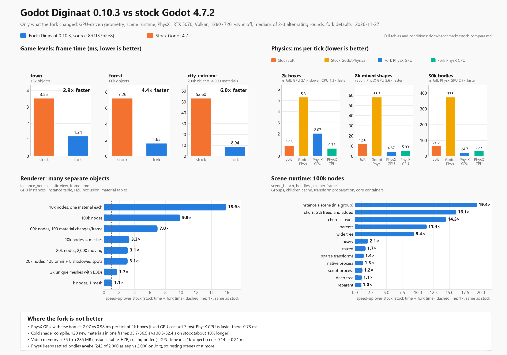

# Stock Godot vs this fork

Runner: `devtools/test/stock_compare.ps1 -Stock <stock console exe>`.
Scenes: `misc/stock_compare_project/` (level and physics benches, stock 4.7
API only), `misc/large_world_test_project/instance_bench.gd` and
`shader_bench.gd`, `devtools/test/scene_bench.gd`. Each engine runs its own
copy of the project; builds alternate every round and the order flips every
other round; one unrecorded rendering run per exe first. Only what the fork
changed is measured: scene runtime, GPU-driven geometry, shader variants,
PhysX.

## Run of 2026-11-27

| | |
| --- | --- |
| Stock | Godot 4.7.2-stable (official) |
| Fork | 4.8-beta custom build `8d1f37b2e8` (own version 0.10.3), `production=yes`, PhysX GPU, Blast, Flow |
| Machine | NVIDIA GeForce RTX 5070, 12 CPU threads, Windows 11, Vulkan, 1280x720, vsync off |
| Fork settings | defaults (GPU instances, instance table, HZB occlusion on); the instance bench passes `--table --gpu-instances --occlusion` because it sets them itself |
| Rounds | level, physics, scene: 3; instance, shader: 2 |

Raw results (every run) are in
[stock-compare-2026-11-27/](stock-compare-2026-11-27/): `rendering.csv`
(warmup, level, instance and shader suites), `physics.csv` and `scene.csv`
(written with the machine's locale, so decimals use commas).

Values are medians over rounds. Round-to-round spread: level 1-3%; physics
up to 6% (GodotPhysics3D) and 6-14% for Jolt in crates_2k, where a tick is
below 1 ms; scene runtime min-max ranges are in the runner output.

### Game-level rendering (`level_bench.gd`)

Shadowed sun (4 cascades), sky, SSAO, glow, camera flying through the level,
separate MeshInstance3D nodes.

| Preset | Content | Stock frame (ms) | Fork frame (ms) | Speed-up | Render CPU stock / fork | GPU stock / fork | Draws stock / fork | VRAM stock / fork (MB) |
| --- | --- | --- | --- | --- | --- | --- | --- | --- |
| town | 15k nodes, 60 meshes, 300 materials, 64 omni, 4 shadowed spots, 400 moving | 3.55 | 1.24 | 2.9x | 2.50 / 0.67 | 0.88 / 0.73 | 7,428 / 1,107 | 167 / 201 |
| forest | 60k nodes, 12 meshes, 24 materials, long shadows | 7.26 | 1.65 | 4.4x | 6.46 / 0.64 | 2.45 / 1.62 | 6,663 / 229 | 158 / 236 |
| city_extreme | 200k nodes, 120 meshes, 4,000 materials, 256 omni, 16 shadowed spots, 5,000 moving | 53.6 | 8.94 | 6.0x | 42.9 / 5.45 | 6.82 / 3.75 | 49,997 / 3,393 | 188 / 472 |

p99 frame: town 5.65 / 2.03, forest 15.3 / 4.32, city_extreme 68.8 / 11.0.

### Many-instance cases (`instance_bench.gd`, static view)

| Case | Stock (ms) | Fork (ms) | Speed-up | Render CPU stock / fork |
| --- | --- | --- | --- | --- |
| small_1k | 0.398 | 0.367 | 1.1x | 0.233 / 0.155 |
| unique_lod_2k | 2.34 | 1.36 | 1.7x | 1.61 / 0.66 |
| shared_20k | 2.72 | 0.82 | 3.3x | 2.49 / 0.31 |
| unique_10k (one material per node) | 6.86 | 0.43 | 15.9x | 5.19 / 0.23 |
| massive_100k | 9.69 | 0.98 | 9.9x | 9.28 / 0.68 |
| dynamic_20k (2,000 moving) | 4.09 | 1.31 | 3.1x | 3.03 / 0.69 |
| lights_20k (128 omni, 8 shadowed spots) | 2.81 | 0.91 | 3.1x | 2.58 / 0.34 |
| churn_100k (100 material changes per frame) | 12.7 | 1.82 | 7.0x | 12.0 / 1.27 |

The orbit views give the same ratios (1.1x to 15.6x).

### Physics (`physics_bench.gd`, headless, `--fixed-fps 60`, ms per tick)

| Preset | Stock Jolt | Stock GodotPhysics3D | Fork PhysX GPU | Fork PhysX CPU | Fork Jolt |
| --- | --- | --- | --- | --- | --- |
| crates_2k (boxes) | 0.98 | 5.30 | 2.07 | 0.73 | 0.62 |
| mixed_8k (boxes, spheres, capsules) | 12.6 | 58.3 | 4.87 | 5.93 | 10.9 |
| extreme_30k | 67.8 | 375 | 24.7 | 36.7 | 52.0 |

No body was lost through the floor in any run. Jolt's default
`max_bodies` (10,240) is too low for 30k bodies; the project raises the Jolt
limits.

### Scene runtime (`scene_bench.gd`, headless, ms per frame)

| Scenario | 10k stock / fork | 100k stock / fork | 100k speed-up |
| --- | --- | --- | --- |
| instance (scene instancing, nodes in a group) | 31.6 / 9.58 | 2,541 / 131 | 19.4x |
| churn (2% freed and added) | 1.07 / 0.31 | 92.9 / 5.76 | 16.1x |
| churn_read | 1.26 / 0.39 | 102.8 / 7.08 | 14.5x |
| wide | 0.106 / 0.039 | 2.76 / 0.29 | 9.4x |
| parents | 0.173 / 0.021 | 2.86 / 0.25 | 11.4x |
| heavy | 1.74 / 0.80 | 49.9 / 23.6 | 2.1x |
| sparse | 0.023 / 0.020 | 0.67 / 0.46 | 1.4x |
| mixed | 0.033 / 0.020 | 0.71 / 0.43 | 1.7x |
| native | 0.122 / 0.154 | 4.86 / 3.60 | 1.3x |
| script | 2.71 / 1.63 | 49.3 / 40.9 | 1.2x |
| deep | 0.55 / 0.48 | 25.5 / 23.6 | 1.1x |
| reparent | 0.082 / 0.079 | 1.46 / 1.41 | 1.0x |

### Cold shader compilation (`shader_bench.gd`, 120 material shaders in one frame)

| | Stock | Fork |
| --- | --- | --- |
| Stall of the spawn frame (ms), per run | 32,414 / 30,342 | 36,533 / 33,656 |
| Steady frame after (ms) | 0.79-0.85 | 0.82-0.83 |

## Where the fork is not better

- **Physics with few bodies on the GPU:** PhysX GPU has a fixed cost per
  tick (about 1.7 ms while settled in crates_2k), so 2k boxes are 2.1x
  slower than stock Jolt. PhysX CPU (0.73 ms) is faster than stock Jolt
  there. PhysX GPU wins from about 8k bodies on (2.6x, 30k: 2.7x).
- **Sleeping:** Jolt sleeps almost every crate in crates_2k (2,000 of
  2,000); PhysX keeps most awake (242 asleep). Settled scenes cost more on
  PhysX.
- **Cold shader stall:** about 10% longer than stock (two runs each). The
  fork's 0.10.2 permutation work was measured against the older fork, not
  against stock.
- **VRAM:** +35 to +285 MB (instance table, HZB, GPU culling buffers);
  +144 MB already in the 1k-node case.
- **GPU time in tiny scenes:** small_1k GPU 0.14 to 0.21 ms (the frame is
  still faster through the CPU side).
- **scene_bench native at 10k:** 0.122 to 0.154 ms (+0.03 ms); 100k is faster.

Fork Jolt is faster than stock Jolt in the 8k and 30k cases (10.9 vs 12.6,
52.0 vs 67.8 ms); not investigated (the 4.8 base, compiler or Jolt version).
